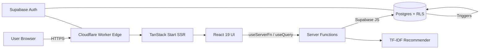
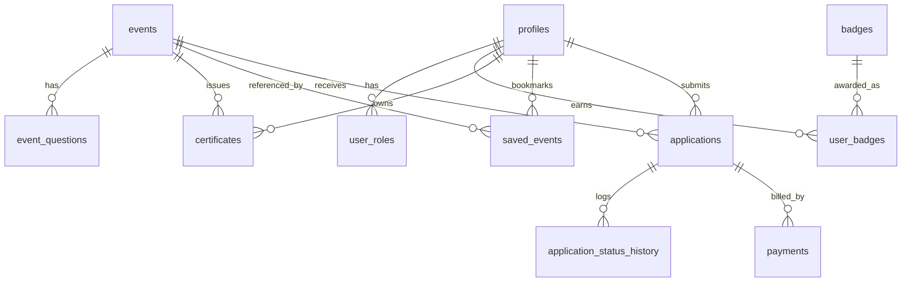
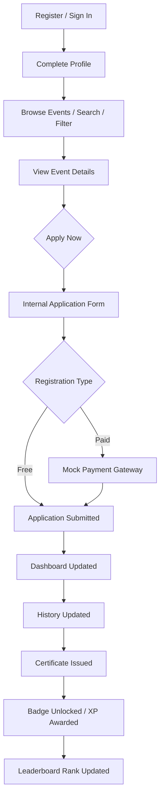
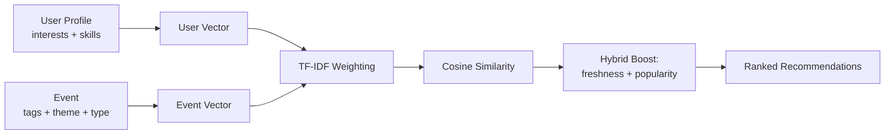

<div align="center">

# 🧭 EventCompass AI

### Smart Technical Event & Hackathon Recommendation Platform

*AI-powered discovery, application, and tracking for hackathons, workshops, bootcamps, contests and conferences.*


</div>

---

## 📚 Table of Contents

1. [Project Overview](#-project-overview)
2. [Features](#-features)
3. [Technology Stack](#-technology-stack)
4. [Project Architecture](#-project-architecture)
5. [Database Design](#-database-design)
6. [Folder Structure](#-folder-structure)
7. [Application Workflow](#-application-workflow)
8. [AI Recommendation System](#-ai-recommendation-system)
9. [Installation Guide](#-installation-guide)
10. [Configuration](#-configuration)
11. [Screenshots](#-screenshots)
12. [API Documentation](#-api-documentation)
13. [Security](#-security)
14. [Performance Optimizations](#-performance-optimizations)
15. [Future Enhancements](#-future-enhancements)
16. [Challenges & Solutions](#-challenges--solutions)
17. [License](#-license)
18. [Author](#-author)

---

## 🌟 Project Overview

**EventCompass AI** is a full-stack web application that helps students, developers, and early-career builders discover and participate in technical events — hackathons, workshops, bootcamps, coding contests, AI/ML events and conferences — from one unified, intelligent hub.

### The Problem

Technical events are scattered across dozens of platforms (Devfolio, Unstop, MLH, Devpost, university portals, LinkedIn posts, Twitter threads). Students routinely miss deadlines, apply late, lose track of registrations, and never see events that best match their skills. There is no single place to **discover**, **apply**, **track**, and **prove** participation.

### The Solution

EventCompass AI centralizes the entire journey:

- 🔎 **Discover** — curated events with rich metadata (theme, eligibility, venue, prize pool, key dates).
- 🤖 **Recommend** — a TF-IDF + cosine-similarity engine matches events to a user's interests and skills.
- 📝 **Apply** — a professional internal application form replaces "open-in-new-tab" external redirects.
- 💳 **Pay** — an in-app mock payment gateway (Card / UPI / Netbanking / Wallet) with full receipt trail.
- 📊 **Track** — dashboard, history, statuses, and payment records auto-updated by database triggers.
- 🏅 **Prove** — verifiable certificates and gamified XP badges reward every milestone.

### Who is it for?

- **Students** looking for opportunities that match their skills.
- **Developers** hunting hackathons and contests worth their weekend.
- **Community organizers / admins** who need to publish and moderate events at scale.
- **Recruiters** browsing verified participation history and certificates.

### Objectives

- One-stop discovery across event categories.
- Personalized, explainable recommendations.
- End-to-end application → payment → certificate lifecycle.
- Gamification (XP, levels, badges) to sustain engagement.
- Production-grade security (RLS, role separation, protected routes).

---

## ✨ Features

### 👤 User Features

| Category | Capabilities |
| --- | --- |
| **Authentication** | Email/password + Google OAuth via Lovable Cloud (Supabase Auth). |
| **Profile Management** | Bio, skills, interests, education, social links, avatar, resume link. |
| **AI Recommendations** | Personalized event feed powered by TF-IDF + cosine similarity over interests, skills, and event tags. |
| **Event Search** | Full-text search across title, organizer, theme and tags. |
| **Filters** | Type, mode (online/offline/hybrid), difficulty, fee (free/paid), date range, tags. |
| **Event Details** | Banner, theme, eligibility, venue with map, key dates, fees, prize pool, contacts, brochure, social links, related events. |
| **Internal Application Form** | Multi-section form: Personal, Technical, Team, and dynamic Custom Questions per event. |
| **Payment System** | In-app mock gateway with Card, UPI, Netbanking, and Wallet options; order/txn/invoice IDs. |
| **Dashboard** | XP, level, streak, application stats, upcoming events, recommendations. |
| **Event History** | Search + status filter + card/table view + CSV export of all applications. |
| **Certificates** | Grid view with year/type filters, download, and verification code. |
| **Badges** | Full catalog of earned and locked badges with XP rewards. |
| **Saved Events** | One-click bookmarking for later. |
| **Leaderboard** | XP-ranked view of top participants (derived from `profiles.xp`). |
| **Notifications** | Toast-based feedback on every user action (via `sonner`). |

### 🛠️ Admin Features

| Category | Capabilities |
| --- | --- |
| **Event CRUD** | Create, update, delete events via `adminUpsertEvent` / `adminDeleteEvent`. |
| **User Management** | Role checks via `has_role` security-definer function. |
| **Application Review** | Status transitions logged automatically via DB triggers. |
| **Payment Monitoring** | Payments table with full audit trail. |
| **Certificate Generation** | Certificates linked to events and users, with verification codes. |
| **Badge Management** | Seeded badge catalog auto-awarded by XP milestones. |
| **Analytics** | Registered counts auto-bumped by triggers for per-event insight. |

---

## 🧰 Technology Stack

| Layer | Technology |
| --- | --- |
| **Frontend** | React 19, TypeScript 5, JSX |
| **Framework** | TanStack Start v1 (SSR + file-based routing) |
| **Build Tool** | Vite 7 |
| **Backend (Server Functions)** | `createServerFn` from `@tanstack/react-start` |
| **Database** | PostgreSQL (Supabase / Lovable Cloud) |
| **Authentication** | Supabase Auth (Email + Google OAuth) |
| **Routing** | TanStack Router (file-based, typed) |
| **Styling** | Tailwind CSS v4, shadcn/ui, Radix UI primitives |
| **Animations** | Tailwind transitions, CSS gradients, `tailwindcss-animate` |
| **State Management** | TanStack Query v5 (server state), React hooks (local state) |
| **Forms & Validation** | React Hook Form + Zod |
| **Recommendation Engine** | Custom TF-IDF + Cosine Similarity (TypeScript, server-side) |
| **Icons** | lucide-react |
| **Notifications** | sonner |
| **Deployment** | Cloudflare Workers (edge runtime, via TanStack Start) |

---

## 🏗️ Project Architecture

EventCompass AI is a **single-repo full-stack app**. The UI, routing, server functions, and API endpoints all live in one TanStack Start project. Server functions run in a Cloudflare Worker; the database is managed Postgres with Row-Level Security.



**Key ideas**

- **Server functions** (`src/lib/*.functions.ts`) are typed RPC endpoints called from the client via `useServerFn`.
- **Row-Level Security** enforces per-user data access; admins are gated by a `has_role()` security-definer function.
- **DB triggers** keep denormalized counters (registrations) and audit logs (status history) consistent.
- **Recommendations** are computed server-side to keep raw event data off the client bundle.

---

## 🗄️ Database Design

<details>
<summary><b>Tables overview</b></summary>

| Table | Purpose |
| --- | --- |
| `profiles` | Extended user profile (bio, skills, interests, XP, level, streak, avatar). |
| `user_roles` | Role assignments (`admin`, `moderator`, `user`) — separate from profile to prevent privilege escalation. |
| `events` | Full event catalog (61 columns: banner, theme, eligibility, venue, dates, fees, prize pool, contacts, social urls, tags). |
| `applications` | Internal application submissions (personal + technical + team + custom answers). |
| `application_status_history` | Immutable audit log of every status transition (driven by trigger). |
| `payments` | Mock payment records with order/txn/invoice IDs and method. |
| `event_questions` | Per-event custom questions used by the application form. |
| `applied_events` | Legacy quick-apply table (superseded by `applications`, kept for continuity). |
| `saved_events` | Bookmarks (user ↔ event). |
| `certificates` | Verifiable certificates with `verification_code` and optional file URL. |
| `badges` | Master badge catalog (icon, XP reward, criteria). |
| `user_badges` | Badge unlocks per user. |

</details>



---

## 📁 Folder Structure

```text
eventcompass-ai/
├── public/
│   └── robots.txt
├── src/
│   ├── components/
│   │   ├── EventCard.tsx
│   │   ├── Navbar.tsx
│   │   └── ui/                    # shadcn/ui primitives
│   ├── hooks/
│   │   └── use-mobile.tsx
│   ├── integrations/
│   │   ├── lovable/
│   │   └── supabase/              # generated client, types, auth helpers
│   ├── lib/
│   │   ├── applications.functions.ts   # apply / pay / status server fns
│   │   ├── events.functions.ts         # events / dashboard / admin
│   │   ├── recommendations.functions.ts# TF-IDF + cosine similarity
│   │   ├── error-capture.ts
│   │   ├── error-page.ts
│   │   └── utils.ts
│   ├── routes/
│   │   ├── __root.tsx
│   │   ├── index.tsx                   # Landing page
│   │   ├── auth.tsx                    # Sign in / sign up
│   │   ├── events.index.tsx            # /events browse
│   │   ├── events.$slug.tsx            # /events/:slug detail
│   │   ├── sitemap[.]xml.ts            # dynamic sitemap
│   │   └── _authenticated/             # gated subtree
│   │       ├── route.tsx               # auth gate
│   │       ├── dashboard.tsx
│   │       ├── profile.tsx
│   │       ├── attended.tsx            # /attended — event history
│   │       ├── certificates.tsx
│   │       ├── badges.tsx
│   │       ├── admin.tsx
│   │       ├── events.$slug.apply.tsx  # internal application form
│   │       ├── payment.$applicationId.tsx
│   │       └── application.$id.tsx     # confirmation & status
│   ├── router.tsx
│   ├── routeTree.gen.ts                # auto-generated (do not edit)
│   ├── server.ts                       # Worker fetch entry
│   ├── start.ts                        # client bootstrap + middleware
│   └── styles.css
├── supabase/
│   └── config.toml
├── components.json
├── vite.config.ts
├── tsconfig.json
└── package.json
```

---

## 🔄 Application Workflow



**Behind the scenes**

1. `submitApplication` inserts into `applications`; a DB trigger bumps `events.registered_count` and logs the initial status.
2. Paid applications route to `/payment/:applicationId`, where `processPayment` writes to `payments` and flips `applications.payment_status`.
3. `progressDemoStatus` simulates realistic status progression (submitted → under_review → shortlisted → accepted).
4. `markAttended` awards +25 XP; XP thresholds unlock badges from the seeded catalog.

---

## 🤖 AI Recommendation System

The recommender is a **content-based hybrid ranker** implemented in TypeScript and executed server-side inside `src/lib/recommendations.functions.ts`.

### Signal sources

- **User vector** — `profile.interests` + `profile.skills` + tags from past applications & saves.
- **Event vector** — `event.tags` + `event.theme` + `event.title` + `event.event_type`.

### Algorithm

1. Tokenize + lowercase both vectors.
2. Build a document-frequency map across the event corpus.
3. Compute **TF-IDF** weights per token.
4. Score each event via **cosine similarity** with the user vector.
5. Apply a **hybrid boost** based on freshness (upcoming deadline) and popularity (`registered_count`).
6. Return the top-N ranked events.



---

## ⚙️ Installation Guide

### 1. Clone

```bash
git clone <this-repository-url>
cd eventcompass-ai
```

### 2. Install dependencies

```bash
bun install
# or
npm install
```

### 3. Configure environment

Copy `.env.example` to `.env` and fill in the values (see [Configuration](#-configuration)).

### 4. Run locally

```bash
bun run dev
# App available at http://localhost:8080
```

### 5. Build for production

```bash
bun run build
```

### 6. Deploy

The project targets **Cloudflare Workers** via TanStack Start's edge output. Deploy through the Lovable dashboard or your Cloudflare account.

---

## 🔐 Configuration

Environment variables consumed by the app:

```env
# .env.example
VITE_SUPABASE_URL="https://<your-project>.supabase.co"
VITE_SUPABASE_PUBLISHABLE_KEY="sb_publishable_xxx"
VITE_SUPABASE_PROJECT_ID="<your-project-ref>"

# Server-only mirrors (used by SSR / server functions)
SUPABASE_URL="https://<your-project>.supabase.co"
SUPABASE_PUBLISHABLE_KEY="sb_publishable_xxx"
SUPABASE_PROJECT_ID="<your-project-ref>"
```

> ⚠️ **Never commit secret keys.** The publishable key is safe to expose; the service-role key is not required for this app.

---

## 📸 Screenshots

> Add screenshots under `docs/screenshots/` and link them here.

| Screen | Preview |
| --- | --- |
| Landing Page | `` |
| Login / Sign Up | `` |
| Dashboard | `` |
| Events Browse | `` |
| Event Details | `` |
| Application Form | `` |
| Payment Gateway | `` |
| History | `` |
| Certificates | `` |
| Badges | `` |
| Admin Panel | `` |
| Leaderboard | `` |

---

## 🧩 API Documentation

All backend logic is exposed as **typed server functions** via `createServerFn`. They are invoked from the client with `useServerFn(...)` and returned data is cached by TanStack Query.

<details>
<summary><b>Events — <code>src/lib/events.functions.ts</code></b></summary>

| Function | Method | Description | Input | Output |
| --- | --- | --- | --- | --- |
| `listEvents` | GET | List all events with filters. | — | `Event[]` |
| `getFeaturedEvents` | GET | Curated featured events for the home page. | — | `Event[]` |
| `getEventBySlug` | GET | Fetch one event by slug. | `{ slug }` | `Event` |
| `getRelatedEvents` | GET | Related events by tags/type. | `{ eventId }` | `Event[]` |
| `getMyDashboard` | GET | Dashboard payload (stats, upcoming, certs). | — | `Dashboard` |
| `getMyHistory` | GET | User's full application/attendance history. | — | `HistoryItem[]` |
| `getAllBadges` | GET | Badge catalog with unlock status. | — | `Badge[]` |
| `toggleSaveEvent` | POST | Bookmark / unbookmark an event. | `{ eventId }` | `{ saved }` |
| `applyToEvent` | POST | (Legacy) quick-apply. | `{ eventId }` | `{ ok }` |
| `markAttended` | POST | Award +25 XP for attendance. | `{ eventId }` | `{ xp }` |
| `updateProfile` | POST | Update profile fields. | `Partial<Profile>` | `Profile` |
| `addCertificate` | POST | Attach a certificate to the user. | `Certificate` | `Certificate` |
| `isAdmin` | GET | Check admin role for current user. | — | `boolean` |
| `adminUpsertEvent` | POST | Create or update an event. | `Partial<Event>` | `Event` |
| `adminDeleteEvent` | POST | Delete an event. | `{ id }` | `{ ok }` |

</details>

<details>
<summary><b>Applications & Payments — <code>src/lib/applications.functions.ts</code></b></summary>

| Function | Method | Description | Input | Output |
| --- | --- | --- | --- | --- |
| `submitApplication` | POST | Submit an internal application form. | `ApplicationPayload` | `{ id, redirect }` |
| `processPayment` | POST | Mock-charge an application and mark it paid. | `{ applicationId, method, simulateSuccess }` | `{ ok, paymentId }` |
| `getApplicationById` | GET | Fetch a single application with event join. | `{ id }` | `Application` |
| `getMyApplications` | GET | List the user's applications. | — | `Application[]` |
| `getEventQuestions` | GET | Custom questions for an event. | `{ eventId }` | `EventQuestion[]` |
| `progressDemoStatus` | POST | Simulate status progression for demos. | `{ applicationId }` | `{ status }` |

</details>

<details>
<summary><b>Recommendations — <code>src/lib/recommendations.functions.ts</code></b></summary>

| Function | Method | Description | Input | Output |
| --- | --- | --- | --- | --- |
| `getRecommendations` | GET | Top-N personalized events for the current user. | `{ limit? }` | `Event[]` |

</details>

---

## 🛡️ Security

- **Authentication** — Supabase Auth with email + Google OAuth. Sessions attached to server functions via `attachSupabaseAuth` middleware.
- **Authorization** — Roles stored in a **separate `user_roles` table** (never on `profiles`) to prevent privilege escalation.
- **Role checks** — `has_role(uuid, app_role)` is a `SECURITY DEFINER` function with a locked `search_path` to avoid recursive RLS.
- **Row-Level Security** — enabled on every public table; policies scope reads/writes to `auth.uid()` or admins.
- **Grants** — every public table has explicit `GRANT` statements for `authenticated` / `service_role`.
- **Input validation** — Zod schemas validate every server-function payload via `.inputValidator()`.
- **Protected routes** — the `_authenticated/` route subtree redirects unauthenticated users to `/auth`.
- **Trigger functions** — internal trigger functions have `EXECUTE` revoked from `anon`/`authenticated` to prevent direct calls.

---

## ⚡ Performance Optimizations

- **SSR + streaming** via TanStack Start (fast first paint at the edge).
- **Route-level code splitting** — every route is its own chunk.
- **Lazy loading** for heavy widgets (maps, charts) behind `<ClientOnly>` boundaries.
- **TanStack Query caching** eliminates redundant fetches across navigation.
- **DB triggers** replace client-side aggregation for counts and history.
- **Indexed columns** on `events.slug`, `applications.user_id`, `applications.event_id`.
- **Pagination-ready** list queries (via `.range()` when needed).
- **Optimistic UI** for save/unsave toggles.

---

## 🚀 Future Enhancements

- 💳 Real payment gateway integration (Razorpay / Stripe).
- 📧 Transactional email notifications (application submitted, status change, certificate ready).
- 📱 React Native / Expo mobile companion app.
- 📅 One-click Google/Apple calendar sync for accepted events.
- 📷 QR-code check-in for on-site attendance verification.
- 🤖 AI chatbot for event Q&A and profile coaching.
- 🏢 Organization dashboard for event hosts (analytics, exports, communications).
- 👥 Team collaboration space (invite, chat, submissions) inside applications.
- 🌐 i18n / multi-language support.
- 🔔 Web push notifications for deadline reminders.

---

## 🧠 Challenges & Solutions

| Challenge | Solution |
| --- | --- |
| Nested route `/events/:slug` colliding with `/events` list page. | Renamed `events.tsx` → `events.index.tsx` so the file router treats `/events` as a leaf and `/events/:slug` as a sibling. |
| RLS recursion on role checks. | Introduced `has_role()` as `SECURITY DEFINER` with a locked `search_path`; roles live in a dedicated `user_roles` table. |
| Keeping `events.registered_count` in sync. | Postgres trigger `trg_bump_event` increments on insert and decrements on delete of `applications`. |
| Auditing status changes. | Trigger `trg_log_app_status` writes to `application_status_history` on every update. |
| SSR crashes bubbling as JSON HTTPError. | `src/server.ts` normalizes h3-swallowed 500s into a rendered error page. |
| Client bundle bloat from server-only modules. | Import protection blocks `src/server/*` and `*.server.ts` from client bundles; server functions live in `*.functions.ts` wrappers. |
| Free vs paid flow branching. | `submitApplication` returns a `redirect` field so the client routes free apps to the confirmation page and paid apps to the mock gateway. |

---

## 📄 License

This project is licensed under the **MIT License**. See below for the full text.

```
MIT License

Copyright (c) 2026 EventCompass AI

Permission is hereby granted, free of charge, to any person obtaining a copy
of this software and associated documentation files (the "Software"), to deal
in the Software without restriction, including without limitation the rights
to use, copy, modify, merge, publish, distribute, sublicense, and/or sell
copies of the Software, and to permit persons to whom the Software is
furnished to do so, subject to the following conditions:

The above copyright notice and this permission notice shall be included in all
copies or substantial portions of the Software.

THE SOFTWARE IS PROVIDED "AS IS", WITHOUT WARRANTY OF ANY KIND.
```

---

## 👤 Author

**EventCompass AI** was built as a full-stack showcase project.

- **Developer:** _Your Name_
- **GitHub:** [github.com/your-handle](https://github.com/your-handle)
- **LinkedIn:** [linkedin.com/in/your-handle](https://linkedin.com/in/your-handle)
- **Email:** _your.email@example.com_

> Replace the placeholders above with your real contact details before publishing.

---

<div align="center">

⭐ **If this project helped you, consider starring the repo!** ⭐

Built with ❤️ using TanStack Start, React 19, Tailwind CSS, and Lovable Cloud.

</div>
